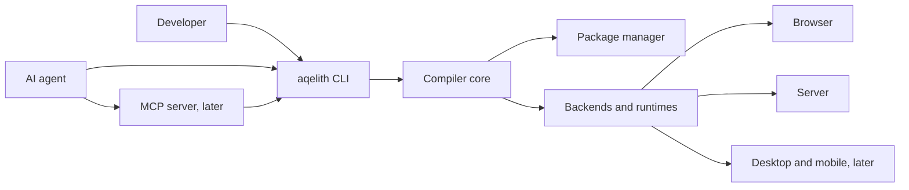
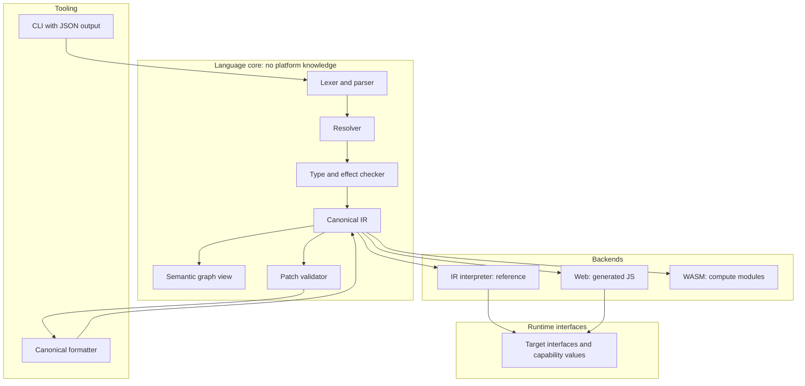

# AQELITH Architecture (M2 synthesis)

Status: **Proposed.** Synthesizes the M2 specifications. Each component names the decision record that justifies it; components without evidence say so.

## 1. System context

The MCP server is a thin client of the CLI and the compiler, never a second implementation (directive §12.1).

## 2. Layers

## 3. Component decisions

| Component | Decision | Record | Evidence status |
|---|---|---|---|
| Implementation language | Rust core, TypeScript glue only for browser | [ADR-0001](../adr/ADR-0001-implementation-language.md) | No language comparison |
| Source authority | Text authoritative; IR derived; patches reprojected | [ADR-0002](../adr/ADR-0002-source-authority.md) | Formatter loop not prototyped |
| Capabilities | Values, attenuable, not serialized | [ADR-0003](../adr/ADR-0003-capability-values.md) | P2 in Rust only |
| Identity | Persistent opaque id plus content hash | [ADR-0004](../adr/ADR-0004-stable-identities.md) | P1 on toy graph |
| Backends | Interpreter first; web JS; WASM for compute; no LLVM v1 | [ADR-0005](../adr/ADR-0005-backend-strategy.md) | Not measured |
| Web rendering | Semantic DOM | [ADR-0006](../adr/ADR-0006-web-rendering.md) | Constraint from directive |
| Resumability | Declared state and handler ids only | [ADR-0007](../adr/ADR-0007-resumability-scope.md) | Skew experiment not run |
| Memory | Single owner, lexical borrows, no GC | [ADR-0008](../adr/ADR-0008-memory-model-v1.md) | Not validated on programs |

## 4. Data flows

- **Compile:** source → parse → resolve → check → IR → backend.
- **Agent edit:** query (returns graph hash) → patch with base hash and preconditions → validate on IR → format → re-parse → re-check → atomic write. A stale or invalid patch never reaches storage.
- **Web request:** server renders view tree to semantic HTML with serialized declared state → browser resumes handlers by id → declared server functions called through typed interface.

## 5. Quality attributes (with status)

| Attribute | Design response | Status |
|---|---|---|
| Performance | Measured methodology; no claims until measured | budgets unset ([../performance/PERFORMANCE_BUDGETS.md](../performance/PERFORMANCE_BUDGETS.md)) |
| Security | Effects, capabilities, threat model | designed; tests not written |
| Portability | Target interfaces; staged targets | no target conforms |
| AI-native | Structured diagnostics, patch API, embedded skills | designed |

## 6. What this architecture does not yet answer

Listed in [OPEN_QUESTIONS.md](OPEN_QUESTIONS.md) and the risks in [RISK_REGISTER.md](RISK_REGISTER.md).
