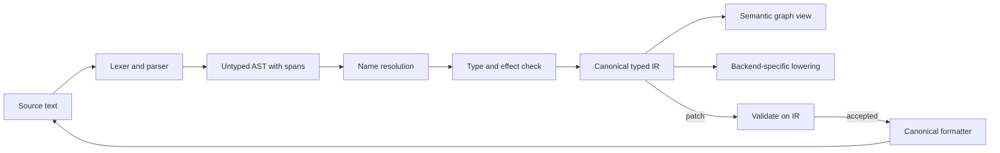

# AQELITH Canonical IR

Status: **Proposed (M2).** Decision basis: [../adr/ADR-0002-source-authority.md](../adr/ADR-0002-source-authority.md).

## 1. Role

The canonical IR is the typed, deterministic, serializable representation that every tool operates on: checker, optimizer, backends, semantic graph queries and patches. It is **derived** from source text by the front end; it is never edited directly by humans.

## 2. Pipeline

The loop closes through the formatter: an accepted patch is printed back to canonical text, and that text is re-parsed and re-checked before it is written. This guarantees the text and the IR cannot diverge, which is the gap the Zerolang audit observed.

## 3. Properties

- **Deterministic:** the same source yields byte-identical IR serialization. IDs are not allocated from wall-clock or random sources.
- **Versioned:** the IR schema has a version number; readers reject unknown versions with a stable error code.
- **Complete for tooling:** every node has a span back to source (or is marked synthetic with its origin).
- **Serializable:** a JSON form for agents and a binary form for speed; both round-trip. JSON is the contract; binary is an optimization that must match JSON exactly (tested).

## 4. Identity

Node identity follows [STABLE_IDENTITIES.md](STABLE_IDENTITIES.md): persistent opaque ids assigned at creation and carried through rename and move, plus a content hash for staleness detection.

## 5. What the IR is not

- Not a second source of truth. If the IR and the text disagree, the text wins and the IR is rebuilt.
- Not stable across compiler versions unless the version rules say so; migration is a tool, not a silent change.
- Not a performance claim. Its cost is measured in [../performance/PERFORMANCE_MODEL.md](../performance/PERFORMANCE_MODEL.md) once a prototype exists.

## 6. Evidence

- AICore: IR is derived from source; its IR JSON reader exists only for migration (PI on "IR is canonical source of truth"). AQELITH takes the derived-IR half and adds the formatter loop, which AICore does not have.
- Zerolang: graph-first with text projection; sync-state commands and a reconciliation layer were needed (see [../research/competitors/zerolang.md](../research/competitors/zerolang.md)).
