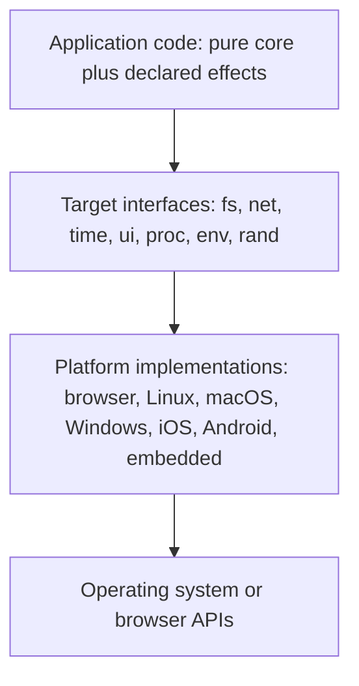

# AQELITH Platform Abstraction

Status: **Proposed (M2).** Interfaces described here are design targets. They become code in M4 and M6.

## 1. Layers

The application depends only on the interfaces. The language core has no knowledge of any platform.

## 2. Interface rules

- An interface method corresponds to one effect in [../security/EFFECT_SYSTEM.md](../security/EFFECT_SYSTEM.md). Calling it requires that effect and a capability value.
- Interfaces return `Result` values with typed errors. A platform that cannot provide a capability returns a typed "unsupported" error; it never silently no-ops.
- Interfaces are versioned. A platform implementation declares which interface versions it implements.

## 3. Capability negotiation

At startup, the runtime reports which capabilities the platform can grant. Programs ask for capabilities by name; a program that requires an unavailable capability fails at startup with a stable error code, before any side effect.

## 4. Cross-compilation and linking

Target-specific linking is isolated in the backend. The core produces the same IR for every target. Linking, toolchain selection and sysroot handling are backend concerns.

## 5. Renderer interface

The UI interface receives a view tree (semantic nodes) and returns events. Web renders it to DOM; desktop and mobile render it through platform widgets, or through a canvas only where a target explicitly chooses to. The view tree is the same across targets, which is why accessibility is defined once ([../app/APPLICATION_MODEL.md](../app/APPLICATION_MODEL.md)).

## 6. What the interface must not do

- Expose raw OS handles to application code.
- Hide the platform from the type system: an effect of `ui` on a server build is a compile error, not a runtime surprise.

## 7. Foreign interface

FFI declarations name the foreign function, its effects and its memory rules. They are trusted boundaries listed in the threat model.
