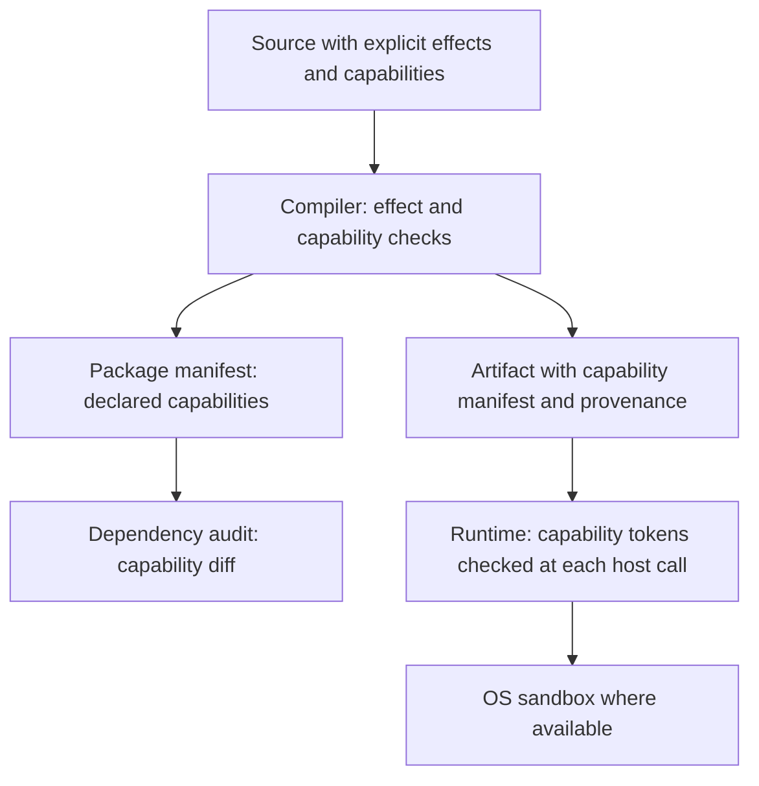

# AQELITH Security Architecture

Status: **Proposed (M2).** Security is part of the language, compiler, package system and runtime, not an add-on (directive §6).

## 1. Layers

Each layer enforces something the layer above cannot. The compiler checks what the code declares; the manifest and audit check what dependencies declare; the runtime checks what is actually called; the OS sandbox limits the damage if the runtime is compromised.

## 2. Compile-time mechanisms

- Effect checking across calls ([EFFECT_SYSTEM.md](EFFECT_SYSTEM.md)).
- Capability values passed explicitly ([CAPABILITY_MODEL.md](CAPABILITY_MODEL.md)).
- Type checks that prevent use-after-move and wrong-type use ([../language/TYPE_SYSTEM.md](../language/TYPE_SYSTEM.md)).
- Explicit `unsafe` regions, if v1 includes them, listed in an audit report.

## 3. Package mechanisms

- Packages declare the capabilities they require; the consumer's policy grants or denies them.
- Lockfile with collision-resistant checksums. Non-cryptographic checksums are not acceptable (Orison audit finding).
- Provenance: a build records its inputs. Signing scheme is open.

## 4. Runtime mechanisms

- Host calls are the only way out of the sandbox; each checks a capability token.
- Tokens are unforgeable within AQELITH programs (checked by the prototype in P2, which tests this only in Rust, not in AQELITH's runtime).
- Denials are recorded in an audit list; denial is a value, not a silent no-op.

## 5. Web-specific mechanisms

- Generated HTML escapes by default; raw HTML requires an effect-marked escape hatch.
- Hydration or resumability state is serialized with an explicit schema and never contains executable code (see [../app/RESUMABILITY.md](../app/RESUMABILITY.md)). The Naze audit found hydration JSON not escaped for `</script>`; the same class of bug is a required test case.
- Content Security Policy compatibility is a requirement for generated apps; the policy itself is an app-level decision.

## 6. What WASM and the browser do not give us

Stated plainly, as the directive requires: WebAssembly sandboxes memory, not logic. Linear memory bugs inside a module are not prevented by WASM (the WebAssembly security documentation says so, see [../research/REFERENCE_ECOSYSTEMS.md](../research/REFERENCE_ECOSYSTEMS.md)). The browser sandbox does not stop an application from misusing data it is allowed to see. Frontend checks never replace backend authorization.

## 7. Verification plan

Each mechanism above has a row in [../testing/SECURITY_TESTING.md](../testing/SECURITY_TESTING.md) with the test that would fail if the mechanism were removed.
